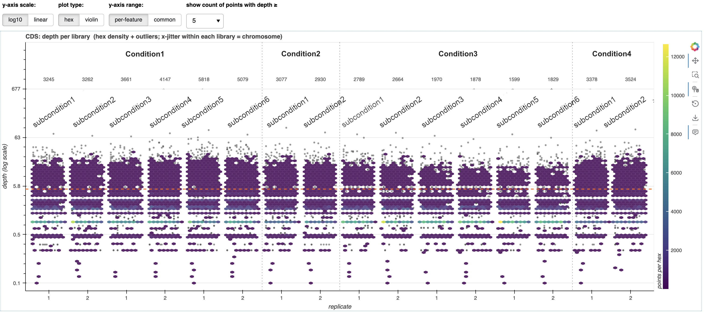

# EM-seq Analysis Pipeline

[](https://github.com/nebiolabs/EM-seq/actions)

This repository contains Nextflow-based analysis tools for [Enzymatic Methylation Sequencing (EM-seq)](https://www.neb.com/products/e7120-nebnext-enzymatic-methyl-seq-kit) and [Enzymatic 5hmC-seq (E5hmC-seq)](https://www.neb.com/en-us/products/e3350nebnext-enzymatic-methyl-seq-5hmc-kit) data processing.

### Main Analysis Pipeline (`main.nf`)
Complete EM-seq processing pipeline that accepts UBAM inputs:
- Parallel processing of byte-range chunks of each uBAM (bamslice)
- Adapter trimming with fastp-compatible QC reports (bamadap)
- Read alignment (bwa-meth) and restoration of uBAM tags onto the alignments (fgumi zipper)
- Duplicate marking (picodup)
- Methylation calling (MethylDackel)
- Quality control metrics and statistics (Picard, Samtools, Falco, tasmanian-mismatch, MultiQC)
- Optional BED file intersection for targeted analysis (bedtools)
- Depth-dependent analyses of CpG-context Cs when enough libraries pass a depth check (see [Depth-dependent analyses](#depth-dependent-analyses))

### Fastq to uBam pipeline (`fastq_to_ubam.nf`)
If your files are in fastq format, you will need to convert them to uBams prior to running the main pipeline, e.g.:
```bash
nextflow run fastq_to_ubam.nf \
  --input_glob "tests/fixtures/fastq/emseq-test*{.ds.1,.ds.2}.fastq.gz" \
  --read_format 'paired-end'
```
| Parameter | Description | Default |
|-----------|-------------|---------|
| `--input_glob` | glob for your gzipped fastq files | `['*.{1,2}.fastq.gz']` |
| `--read_format` | 'paired-end' or 'single-end' | `'paired-end'` |

### Feature Coverage & Methylation Analysis (`feature_cov_meth.nf`)
Quantifies read depth and CpG methylation across major genomic feature categories — exons, CDS, genes, mRNA, CpG islands, and EPD promoters — for a set of aligned BAM files.

**Outputs**
- `feature_depth_bokeh.html` — interactive per-feature depth plot (switchable in-browser between hex-density and violin display, log/linear y-axis, per-feature or shared y-range, and a depth-threshold counter)



- `feature_cov_meth.html` — one dot per feature category per library. The views are
  mean methylation against relative coverage, coverage by library, and methylation by library.
  Relative coverage is the mean per-base read depth over a category's features (mosdepth)
  divided by the genome-wide mean depth, so 1 is the genome average. Per-base depth is
  used rather than overlapping-fragment counts, which inflate short features such as
  60 bp promoters several-fold. This replaces the Tableau
  "Feature Coverage vs Methylation" sheet.
- `feature_cov_meth_summary.tsv` — the values behind `feature_cov_meth.html`
- `combined_feature_counts.tsv` — merged featureCounts table across all feature types
- Per-sample methylation TSVs under `<output_dir>/features/<sample>/<context>/`

**Usage**
```bash
nextflow run feature_cov_meth.nf \
  --bam_files_glob '*.md.{bam,bam.bai}' \
  --mk_files '*.methylKit.gz' \
  --human_t2t2
```
Use `--mouse` for GRCm39, `--human_t2t2` for T2T CHM13v2.0, or supply all genome params manually for a custom assembly.

| Parameter | Description | Default |
|-----------|-------------|---------|
| `--mouse` | GRCm39 reference shortcuts | `false` |
| `--human_t2t2` | T2T CHM13v2.0 reference shortcuts | `false` |
| `--local_ref_files_path` | Root path to locally cached reference files | *(set in config)* |
| `--context` | Methylation context(s), comma-separated (`CpG`, `CHG`, `CHH`) | `CpG` |
| `--count_dup_reads` | Include duplicate reads in feature counts | `false` |
| `--output_dir` | Output directory | `cov_vs_meth.output` |

For custom assemblies set `--genome`, `--ucsc_cpg_islands_gtf`, `--refseq_gff_url`, `--ncbi_assembly_report_url`, `--epd_promoter_bed_url`, `--old_new_chain_url`, `--cpg_chr_lookup`, and `--refseq_chr_lookup` directly.

## Quick Start
1. Install [miniforge](https://conda-forge.org/download/) and [bioconda](https://bioconda.github.io/) (see [Requirements](#requirements))
2. Install [Nextflow](https://www.nextflow.io/) (e.g. conda install nextflow, or see [Nextflow installation guide](https://www.nextflow.io/docs/latest/getstarted.html#installation))
3. Clone this repository (`git clone https://github.com/nebiolabs/EM-seq.git`). Modify `nextflow.config` as needed for your environment, e.g. if running locally, change executor block to 'local' and set, e.g. `--max_cpus 10 --max_memory 30.GB`. 
4. Download or prepare a genome reference FASTA file (see [Reference Genomes](#reference-genomes))
5. Create a bwameth index for the fasta and add it to your references in conf/references.config
6. Run the pipeline with appropriate parameters (see [Basic Usage](#basic-usage))
7. Examine results in the EM-seq_output directory
   - `EM-seq-Alignment-Summary-<FLOWCELL_ID>_multiqc_report.html` in em-seq_output for overall QC summary
   - Mbias files `em-seq_output/methylDackelExtracts/mbias` (to identify sample-dependent positional biases)
   - Methylation output files in `em-seq_output/methylDackelExtracts` (suitable for analysis with [methylKit](https://bioconductor.org/packages/release/bioc/html/methylKit.html))
   - Aligned reads in `em-seq_output/markduped_bams` (methylation coloring is recommended for visualization in [IGV](https://igv.org/doc/desktop/#UserGuide/tracks/alignments/bisulfite_sequencing/))

### Basic Usage
```bash
nextflow run main.nf \
  --genome 'test' \
  --ubam_dir './' \
  --email your.email@example.com \
  --flowcell FLOWCELL_ID \
  --adapter_set 'Illumina'
```
`ubam_dir` should be the folder where your ubam files are.

### Key Parameters
| Parameter | Description | Default |
|-----------|-------------|---------|
| `--genome` | reference genome found in conf/references.config | Required |
| `--email` | Email for notifications | Required |
| `--flowcell` | Flowcell identifier | Optional |
| `--outputDir` | Output directory | `em-seq_output` |
| `--enable_neb_agg` | Enable NEB aggregation reporting | `False` |
| `--adapter_set` | adapter set found in conf/adapter_sequences.config (`Illumina`, `Element`, `MGI`,  `Nextera-mosaic`) | Required |
| `--methyl_quality_threshold` | Minimum MAPQ for a read to count in MethylDackel's calls | `20` |
| `--methyldackel_trim` | Read positions MethylDackel ignores in every extract (`--nOT`/`--nOB`) | `--nOT 0,0,0,5 --nOB 0,0,5,0` |
| `--multiqc_gc_group` | contig group whose GC bias curve MultiQC plots (see [GC bias curves](#gc-bias-curves)) | largest group |

### Depth-dependent analyses

After alignment, `main.nf` checks whether the libraries are deep enough to reason about
individual cytosines. mosdepth measures the mean depth of every contig in each library, counting
only the reads MethylDackel uses (MAPQ ≥ `--methyl_quality_threshold`, no duplicates, secondary,
supplementary or QC-failed reads). A library passes when every checked contig has a mean depth above
`--depth_dependent_min_contig_depth` (5x). Checked contigs are the autosomes: the `contig_groups.tsv` types
in `--depth_dependent_check_contig_types`, or, for a genome without `gc_groups_dir`, every contig that is
not a control, organelle, sex chromosome or unplaced. Sex chromosomes are left out because chrY
has no coverage in female samples. The depth-dependent analyses run only when at least
`--depth_dependent_min_libraries` (2) libraries pass. Otherwise none of their tasks start.
`depth_dependent/depth_dependent_check.tsv` and `depth_dependent/depth_dependent_contig_depth.tsv` record the
decision for every run.

Every count in the analyses is of CpG-context Cs: the two Cs of a CpG, one per strand, count
separately, and each C's depth is the number of strand-specific overlapping reads (as MethylDackel reports them).
Reference Cs exclude spike-in controls and organelles; with `gc_groups_dir` set, only
`autosomal` and `sex_chromosome` contigs count.

Once enough libraries pass, the pipeline merges every library, shallow ones included, into one per-C
table and writes `<tag>_depth_dependent_report.html` at the top of the output directory, next
to the MultiQC report. The tag comes from the library names, split on `_` and `-`. It holds up to
three of the name parts that the most libraries share, as long as at least half of them use it.
`EMseq_NA12878_10ng_1`, `EMseq_NA12878_1ng_2`, `EMseq_HeLa_10ng_1` and `EMseq_HeLa_1ng_2` give
`EMseq_NA12878_HeLa`. Masses, replicate numbers and single letters never count, because they mark
the design rather than the experiment. Without a shared part the tag is the range of input
amounts in the names, such as `0.1ng-100ng`. Without either the name has no tag. A toggle at the top sets the minimum depth a C needs to
count as covered (`--depth_dependent_report_depths`, opening at `--depth_dependent_min_depth`); every
cross-library tab follows it. The report has these tabs:

- **Overview** — one row per library: the parts of its name (input amount, replicate, others),
  primary reads, % mapped, % duplicates, % usable reads (the reads MethylDackel uses: mapped,
  not duplicates, QC failures or supplementary, MAPQ ≥ `--methyl_quality_threshold`, and properly
  paired when paired) and effective coverage (mean depth per reference C) as a labelled bar.
  Read counts need the BAMs, which `main.nf` has; `depth_dependent.nf` takes them with `--bam_files`.
- **Depth** — fraction (or number) of reference Cs covered at depth ≥ X for every library, and
  each library's shallowest checked contig and depth check result.
- **Upset** — reference Cs per coverage pattern.
- **Correlation** — pairwise methylation Pearson r on shared Cs, coverage r over all reference
  Cs, and Jaccard index of covered Cs. A pair explorer plots methylation in one library
  against another, with each library's histogram along its axis. A "not observed" strip and bar
  hold Cs that one library covers and the other does not.
- **All pairs** — one matrix of every library pair: depth of every reference C below the
  diagonal (grey), methylation histograms on the diagonal, and methylation of shared Cs above
  it, each cell with its Pearson r and the number of Cs it shows. Checkboxes hide libraries,
  and a line gives the Cs covered in every shown library. A **core set** view drops libraries
  that would shrink the common Cs drastically: it is the largest set of libraries (whole name
  groups when the names group) whose set Jaccard of covered Cs (common / union) reaches
  `--depth_dependent_core_jaccard` at `--depth_dependent_core_depth`. In that view every cell and histogram
  uses only the Cs that every core library covers.
- **Clustering** — average-linkage dendrograms over 1 − r and 1 − Jaccard.
- **Library-specific Cs** — Cs covered in exactly one library, and their methylation.

| Parameter | Description | Default |
|-----------|-------------|---------|
| `--depth_dependent_min_contig_depth` | A library passes the depth check when every checked contig's mean depth is above this | `5` |
| `--depth_dependent_min_libraries` | Libraries that must pass for the analyses to run (0 runs them regardless of depth) | `2` |
| `--depth_dependent_check_contig_types` | `contig_groups.tsv` types the depth check covers | `autosomal` |
| `--depth_dependent_min_depth` | Depth a C needs to count as covered when the report opens | `10` |
| `--depth_dependent_report_depths` | Minimum depths offered by the report's depth toggle | `1,3,5,10,20,30` |
| `--depth_dependent_core_jaccard` | Set Jaccard the core set must reach (0 disables the core view) | `0.85` |
| `--depth_dependent_core_depth` | Depth at which a C counts as covered when choosing the core set | `1` |
| `--depth_dependent_write_matrix` | Write `depth_dependent_matrix.parquet`: depth and methylated count per C per library | `true` |
| `--skip_depth_dependent` | Skip these analyses | `false` |

The tables behind the report are in `depth_dependent/`. They include `depth_dependent_pairwise.tsv`,
`depth_dependent_upset.tsv` and `depth_dependent_clusters.tsv` (leaf order and Newick tree per metric).
Changing the depth check settings with `-resume` re-runs only the check's decision; the mosdepth tasks
are reused.

To run the analyses on BAMs that are already aligned and duplicate-marked:
```bash
nextflow run depth_dependent.nf --genome T2T_chm13v2.0+meth_controls --bam_files 'bams/*.bam'
```
The BAMs need an index (`<name>.bam.bai` or `<name>.bai`). Library names are the BAM names
with trailing lowercase dot-tags removed (`1ng_x_1.ds.md.bam` becomes `1ng_x_1`). The BAMs go
through the depth check, and MethylDackel extracts CpG methylKit files only after enough pass.
To reuse methylKit files from an earlier run, add
`--mk_files 'em-seq_output/methylDackelExtracts/*_CpG.methylKit.gz'`. `--mk_files` without
`--bam_files` runs the analyses without the depth check and without read counts on the Overview tab. Add
`--feature_cov_dir <feature_cov_meth.nf output_dir>` to include that run's feature coverage and
depth plots in the same report, under a **Feature coverage** tab.

### References Config

Modify the conf/references.config file to specify your genome files
- `genome_fa` path to your genome fasta file 
- `genome_fai` path to your genome fasta fai file 
- `bwameth_index` path to your genome fasta file where bwameth indices exist 
- `target_bed` BED file for targeted analysis, Optional 
- `gc_groups_dir` directory of per-organism GC bias references, Optional (see below)

### GC bias curves

Picard measures GC bias by comparing where reads start against the GC of every window in the
reference it is given, so a composite reference reports one curve blended across every organism in
it. Setting `gc_groups_dir` for a genome adds a separate curve per organism alongside the
whole-reference one. The directory holds a `contig_groups.tsv` assigning each contig to a group,
plus a `<group>.fa`/`.fa.fai`/`.dict` per group; the contigs to keep and the region BED are derived
from each group's `.fa.fai` at run time. The directory is validated against `genome_fai` and
against `contig_groups.tsv` at startup.

MultiQC plots a single curve per library. By default that is the curve of the group with the most
windows -- the host organism for the `+meth_controls` references -- because the whole-reference curve
counts the spike-in controls, and pUC19 (51% GC), lambda (50%) and Xp12 (68%) pull it noticeably
away from a host-only curve. Use `--multiqc_gc_group <name>` to plot a different group.

Without `gc_groups_dir` you get the whole-reference curve alone, controls included; the run warns
that it is not directly comparable to a host-only curve.

Group definitions for the published references ship in
[`assets/contig_groups/`](assets/contig_groups/); the per-group FASTA subsets they refer to are
built separately and are not part of this repository.

### Advanced Options
- `--tmp_dir` - Temporary directory (default: `/tmp`)
- `--workflow` - Workflow identifier (default: `EM-seq`)
- `--enable_neb_agg` - Enable NEB aggregation reporting (default: `False`)


## Reference Genomes

Pre-built reference genomes with methylation spike-in controls, plus matching UCSC CpG island
annotations. These are the same references NEB uses internally:

| Species | Assembly | Genome FASTA | CpG islands gtf |
|---|---|---|---|
| Human | T2T CHM13v2.0 | [T2T_chm13v2.0+meth_controls](https://neb-em-seq-sra.s3.us-east-1.amazonaws.com/T2T_chm13v2.0%2Bmeth_controls.fa.gz) | [t2t_cpg_islands](https://neb-em-seq-sra.s3.us-east-1.amazonaws.com/human_t2t_cpg_islands.gtf) |
| Human | GRCh38 | [grch38_core+meth_controls](https://neb-em-seq-sra.s3.us-east-1.amazonaws.com/grch38_core%2Bmeth_controls.fa.gz) | [grch38_cpg_islands](https://neb-em-seq-sra.s3.us-east-1.amazonaws.com/human_grch38_cpg_islands.gtf) |
| Mouse | GRCm39 | [grcm39+meth_controls](https://neb-em-seq-sra.s3.us-east-1.amazonaws.com/grcm39%2Bmeth_controls.fa.gz) | [grcm39_cpg_islands](https://neb-em-seq-sra.s3.us-east-1.amazonaws.com/grcm39_cpg_islands.gtf) |

Download and unzip the FASTA, then add its paths to `conf/references.config` (see
[References Config](#references-config)). The pipeline reads the reference from disk and never
fetches it, so it also needs a `.fai` and a bwameth index alongside; `main.nf` checks for both at
startup and prints the command to build whichever is missing.

The CpG island files are only used by `feature_cov_meth.nf`. Pass one with
`--ucsc_cpg_islands_gtf`, or save the downloads under `--local_ref_files_path` (default
`~/nebnext_projects/em-seq/em-seq_ref_files`) keeping their names, and the `--mouse` and
`--human_t2t2` shortcuts will find them. GRCh38 has no shortcut, so it always needs these
parameters passed explicitly.

Per-organism GC bias curves for these references are configured by the group definitions in
[`assets/contig_groups/`](assets/contig_groups/) — see [GC bias curves](#gc-bias-curves).

> If you already have one of these references from before September 2026, re-download it. The
> `phage_lambda`, `phage_T4` and `phage_Xp12` control sequences were corrected to match RefSeq, so
> an older copy gives control metrics that are not comparable. You must rebuild the bwameth index
> and the `.fai` after replacing the FASTA.

- Create your own reference by appending the [control sequences](assets/methylation_controls.fa) to your preferred genome fasta (e.g. `cat genome.fa methylation_controls.fa > genome+methylation_controls.fa`)
   | Sequence | Methylation State                                | Purpose |
   |----------|--------------------------------------------------|---------|
   | lambda   | All Cs are unmodified (included in kits)         | confirmation that APOBEC enzyme is working optimially (unprotected C->T)  |
   | pUC19c   | All CpG sites contain 5mC (included EM-seq kits) | confirmation that TET2 + T4-BGT step is protecting 5mC (5mC -> 5ghmC/5caC |
   | T4       | All Cs are 5hmC (included in the 5-hmC Seq kits) | confirmation that T4-BGT is protecting 5hmC optimally (5hmC -> 5ghmC)     |

## Requirements
- [Nextflow](https://www.nextflow.io/)
- [Miniforge](https://conda-forge.org/download/), [Micromamba](https://mamba.readthedocs.io/en/latest/installation/micromamba-installation.html), or [Conda](https://docs.conda.io/projects/conda/en/stable/) for dependency management
- [Bioconda](https://bioconda.github.io/) channel configured
- Sufficient computational resources (memory scales with input size)

### Historical Workflows
These in the "legacy" folder are retained for reference and reproducibility but are not actively maintained and are not compatible with the latest Nextflow versions. Use `NXF_VER=22.10.4 nextflow run ...` to reproduce the results in the [EM-seq paper](README#Citation).
- `em-seq.nf` - Original alignment and methylation calling workflow
- `bins.nf` - TSS-centered binned coverage analysis
- `cov_vs_meth.nf` - Coverage vs methylation analysis for genomic features

## Citation
Analysis methods in this repository were used in the following publication:

Vaisvila R, Ponnaluri VKC, Sun Z, et al. **Enzymatic methyl sequencing detects DNA methylation at single-base resolution from picograms of DNA.** *Genome Res.* 2021;31(7):1280-1289. doi:[10.1101/gr.266551.120](https://doi.org/10.1101/gr.266551.120)

## Related Projects
 - We have a related project to call variants in EM-seq converted libraries: [EM-seq variant calling](https://github.com/nebiolabs/EM-seq_variant_calling)
 - You may also be interested in the [nf-core methylseq project](https://nf-co.re/methylseq/2.5.0)

## Developer documentation
### Production:
 - git tag -f current_production
 - git push -f origin current_production

 ### Development:
 - development workflow will run from master branch

 ### Testing:
 - Tests are run using nf-test and are integrated into github actions
 - install nf-test from bioconda using conda/mamba
 - To run all tests:
 ```bash
nf-test test
```
- When new tests are added or results change, to update the results snapshot:
```bash
nf-test test --updateSnapshot
```

## Upgrade
This pipeline requires Nextflow >=25.04, where topic channels (used throughout for
version reporting) are a stable feature rather than a preview one. `main.nf` checks
this at startup and fails immediately with a clear message on older versions. 
